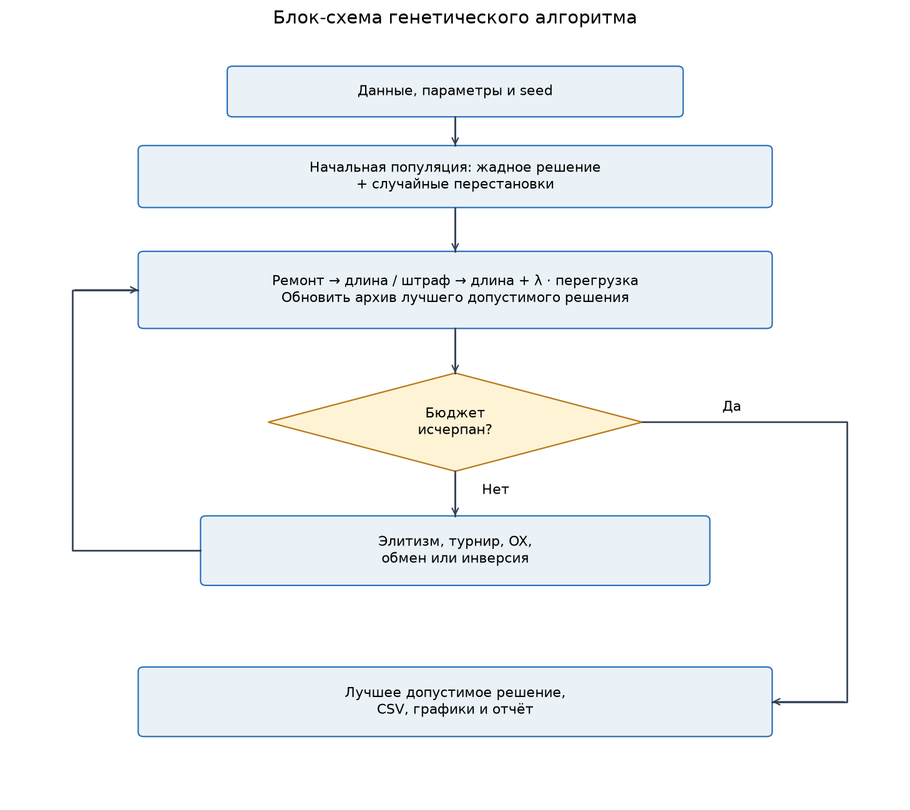
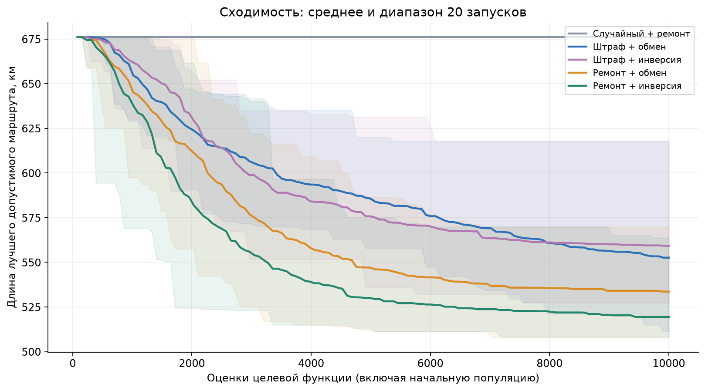
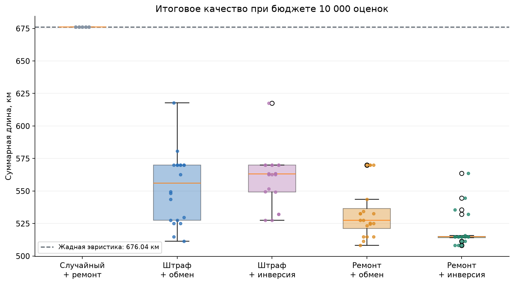
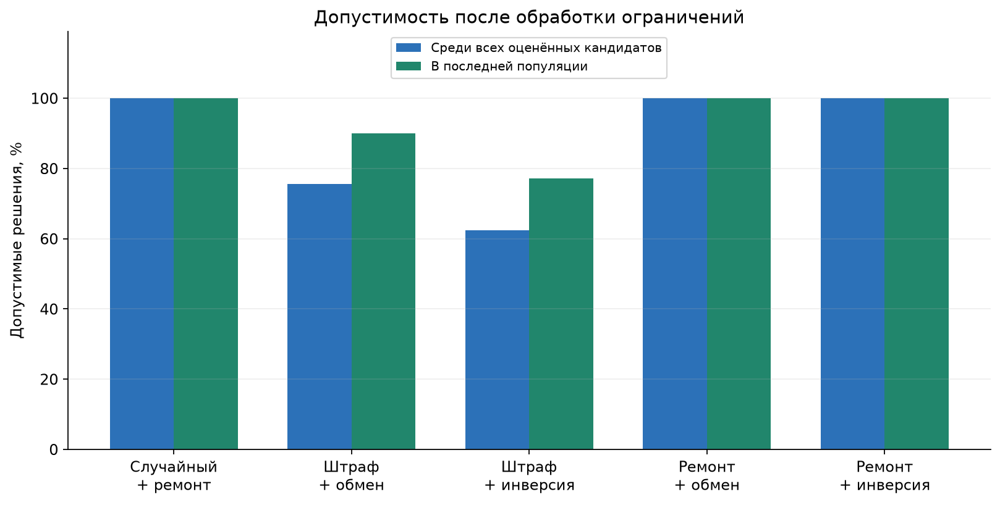
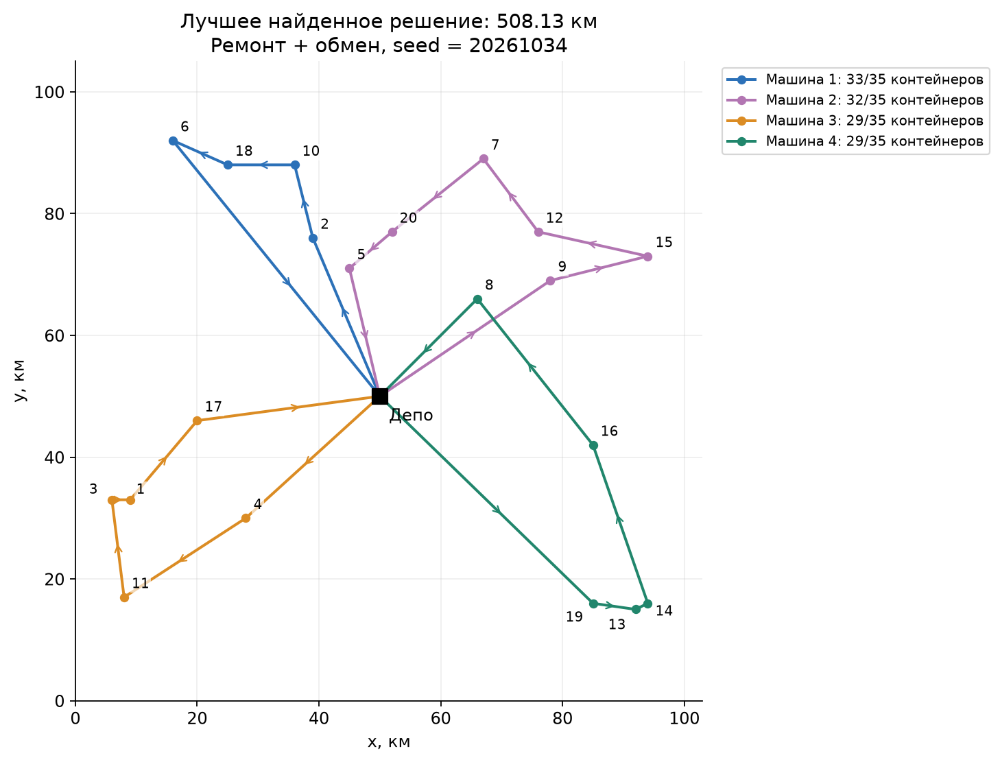

# Лабораторная работа № 2

Генетический алгоритм для дискретной задачи с ограничениями. Вариант 13: маршрут сбора бытовых отходов с ограничением грузоподъёмности.

## 1. Цель и постановка

Цель — разработать дискретное представление маршрутов, специализированные операторы и обработку ограничений, затем исследовать их на серии независимых запусков. Вариант 13 принят по выполненной лабораторной работе № 1.

В районе находятся 20 контейнерных площадок и депо (вершина 0). Доступны 4 одинаковые машины вместимостью Q = 35 контейнеров. Каждая площадка обслуживается ровно один раз одной машиной; деление её объёма между машинами запрещено. Каждый маршрут начинается и заканчивается в депо. Промежуточные выгрузки и дополнительные рейсы одной машины не предусмотрены; пустой маршрут разрешён.

Расстояние d(i,j) = √((xᵢ − xⱼ)² + (yᵢ − yⱼ)²). Координаты заданы в условных километрах. Это синтетическая евклидова модель района; дорожная сеть, пробки, время обслуживания и различия машин не моделируются. Количество машин задано как часть подготовленного экземпляра: методичка для варианта 13 его не фиксирует.

Решение R = (R₁, …, Rₖ), где Rᵣ — упорядоченный список площадок. Требуется минимизировать:

L(R) = Σᵣ [d(0, Rᵣ[1]) + Σⱼ d(Rᵣ[j], Rᵣ[j+1]) + d(Rᵣ[last], 0)].

Для пустого маршрута вклад равен 0. Ограничения: объединение Rᵣ равно {1, …, 20}, маршруты попарно не пересекаются, а Σᵢ∈Rᵣ qᵢ ≤ Q для каждой машины. Все площадки обязательны. Общий объём 123, вместимость парка 140; необходимо минимум ceil(123/35) = 4 машин. Достаточность проверена построением допустимого разбиения.

## 2. Входные данные

Источник — собственный генератор `src/generate_instance.py`, `random.Random(132026)`. Депо расположено в (50, 50). Для каждой из 20 площадок последовательно генерируются целые x, y из [5, 95] и объём из [3, 9] равномерным `randint`. Файл `data/waste_collection.json` приложен. Округление расстояний при оптимизации не выполняется.

| Точка | x | y | Объём, контейнеров |
| ---: | ---: | ---: | ---: |
| 0 | 50 | 50 | 0 |
| 1 | 9 | 33 | 6 |
| 2 | 39 | 76 | 9 |
| 3 | 6 | 33 | 3 |
| 4 | 28 | 30 | 5 |
| 5 | 45 | 71 | 4 |
| 6 | 16 | 92 | 9 |
| 7 | 67 | 89 | 3 |
| 8 | 66 | 66 | 4 |
| 9 | 78 | 69 | 7 |
| 10 | 36 | 88 | 6 |
| 11 | 8 | 17 | 6 |
| 12 | 76 | 77 | 5 |
| 13 | 92 | 15 | 8 |
| 14 | 94 | 16 | 5 |
| 15 | 94 | 73 | 9 |
| 16 | 85 | 42 | 4 |
| 17 | 20 | 46 | 9 |
| 18 | 25 | 88 | 9 |
| 19 | 85 | 16 | 8 |
| 20 | 52 | 77 | 4 |

## 3. Генотип, фенотип и допустимость

Генотип — перестановка 23 уникальных токенов: площадки 1…20 и разделители −1, −2, −3. Порядок меток разделителей не влияет на декодирование: каждый отрицательный токен начинает следующий маршрут. Например, `[1, 2, -1, 3, -2, 4, -3, 5, …]` задаёт четыре списка площадок. Фенотип — эти списки с добавленным депо в начале и конце.

Представление непосредственно кодирует порядок обслуживания и распределение между машинами. Оно гарантирует однократное посещение всех площадок, если перестановка корректна. Уникальные метки разделителей позволяют применять OX без повторов генов. Смежные разделители означают пустые маршруты. При записи маршрутов метки канонизируются, но их множество сохраняется. Разные перестановки могут декодироваться в одно решение из-за перестановки одинаковых машин.

Два допустимых и два недопустимых решения приведены ниже. Все четыре содержат каждую площадку ровно один раз; недопустимость связана именно с перегрузкой.

| Пример | Генотип | Нагрузки машин | Суммарная перегрузка |
| --- | --- | --- | ---: |
| Допустимое 1: жадное решение | `[5, 2, 10, 18, 20, 7, -1, 8, 9, 12, 15, 16, 14, -2, 4, 17, 1, 3, 11, -3, 19, 13, 6]` | [35, 34, 29, 25] | 0 |
| Допустимое 2: лучшее найденное | `[2, 10, 18, 6, -1, 9, 15, 12, 7, 20, 5, -2, 4, 11, 3, 1, 17, -3, 19, 13, 14, 16, 8]` | [33, 32, 29, 29] | 0 |
| Недопустимое 1: все точки у одной машины | `[1, 2, 3, 4, 5, 6, 7, 8, 9, 10, 11, 12, 13, 14, 15, 16, 17, 18, 19, 20, -1, -2, -3]` | [123, 0, 0, 0] | 88 |
| Недопустимое 2: перенос в заполненную машину | `[5, 2, 10, 18, 20, 7, 14, -1, 8, 9, 12, 15, 16, -2, 4, 17, 1, 3, 11, -3, 19, 13, 6]` | [40, 29, 29, 25] | 5 |

Машиночитаемая версия: `results/constraint_examples.json`. Валидация отдельно отклоняет пропущенные, повторяющиеся и неизвестные токены.

## 4. Генетический алгоритм

Начальная популяция содержит 80 особей: одно общее для всех методов допустимое жадное решение и 79 случайных перестановок всех токенов. Жадная эвристика выбирает ближайшую ещё не обслуженную площадку, которая помещается в машину, затем переходит к следующей машине; при необходимости применяется ремонт.

Родители выбираются турниром размера 3 без повторов внутри турнира. OX с вероятностью 0,9 копирует случайный сегмент первого родителя и циклически заполняет остальные позиции токенами второго родителя с пропуском уже использованных. Поэтому все площадки и разделители остаются ровно в одном экземпляре. С вероятностью 0,1 копируется первый родитель.

Мутация применяется к потомку с вероятностью 0,3. **Обмен** меняет местами два токена и позволяет локально менять порядок или назначение машине. **Инверсия** разворачивает сегмент между двумя случайными позициями включительно. Для симметричных расстояний она меняет внутренние рёбра иначе, чем обмен; если в сегмент попали разделители, меняется распределение площадок. Обе операции сохраняют перестановку, но могут нарушить вместимость.

Две лучшие особи по используемой фитнес-функции переносятся элитизмом без повторного оценивания. Остальные создаются заново. Отдельный архив сохраняет лучшее **допустимое** решение. Остановка — ровно 10 000 оценок целевой функции, включая начальные 80; последнее поколение при необходимости укорочено. При этих параметрах выполняется 128 поколений после инициализации. Неполная последняя популяция корректно учитывается в доле допустимости.

## 5. Работа с ограничениями

**Штраф.** Минимизируется F = L + λ · O, где O = Σᵣ max(0, loadᵣ − Q), λ = 10 000 км/контейнер. Недопустимые особи могут оцениваться и участвовать в размножении; в архив допускаются только допустимые. Коэффициент выбран с явным запасом: длина любого допустимого решения не превышает (n + k) · d_max = 2613.687 км. Поскольку объёмы целочисленные, любое нарушение даёт O ≥ 1 и штраф ≥ 10 000. Поэтому любая допустимая особь предпочтительнее любой недопустимой; внутри недопустимых преимущество получают меньшая перегрузка и длина. Это жёсткий вариант штрафа, и выводы о нём не распространяются на произвольный λ.

**Ремонт.** До оценки особи из наиболее перегруженного маршрута переносятся площадки в маршруты со свободной вместимостью. Выбор сначала предпочитает устранение перегруза одним переносом, затем минимальный остаток до вместимости и более заполненный принимающий маршрут; равенства разрешаются по ID площадки и машины. Площадка добавляется в конец принимающего маршрута. Учитываются объёмы, целевая функция внутри ремонта не вычисляется.

Если ни один одиночный перенос невозможен, выполняется упаковка по убыванию объёма в первый подходящий маршрут (FFD), а порядок внутри маршрутов берётся из исходной перестановки. FFD не гарантирует успех на произвольной задаче: если он не сработал, используется заранее проверенное допустимое разбиение с восстановлением порядка по исходной особи. При загрузке экземпляра программа проверяет наличие такого разбиения; при неудаче сообщает ошибку, а не выдаёт недопустимый результат. Для приложенных данных ремонт всегда возвращает допустимое решение. Локальный поиск по длине маршрутов не применяется.

## 6. План эксперимента

Проведено 20 независимых запусков **каждой** из пяти конфигураций, всего 100 запусков и 1 000 000 поисковых оценок. Seed запусков: 20261019…20261038. Для сопоставления методы используют одинаковый список seed; после различных операций их случайные последовательности расходятся. Запуски одной конфигурации используют отдельные генераторы.

Полный план 2 × 2: штраф/ремонт × обмен/инверсия. При сравнении пары меняется только один из этих факторов. Популяция, турнир, элитизм, вероятности и бюджет фиксированы в `configs/experiment.json`.

Базовые методы: детерминированная конструктивная эвристика и случайный допустимый поиск. Последний получает тот же начальный жадный маршрут (одна оценка), затем 9999 случайных перестановок с тем же ремонтом. Это выборка, смещённая процедурой ремонта; она не равномерна на пространстве допустимых маршрутов. В данной серии ни одна случайная особь не улучшила начальное жадное решение, поэтому результаты случайного метода совпали во всех запусках.

Бюджет относится к полным оценкам длины и перегрузки; расстояния предвычислены. Проверка готового результата выполняется после поиска и не включается в бюджет. Ремонт и селекция требуют дополнительных операций, поэтому одинаковое число оценок не означает одинаковое процессорное время; ниже приведено фактически измеренное время на текущем компьютере. Время загрузки и построения графиков в него не входит.

## 7. Результаты

Все числа качества относятся к **лучшему допустимому** решению запуска. Меньше — лучше. Стандартное отклонение выборочное, с делителем 19.

| Метод | Запуски | Лучшее, км | Среднее | Медиана | Станд. откл. | Худшее |
| --- | ---: | ---: | ---: | ---: | ---: | ---: |
| Случайный поиск + ремонт | 20 | 676.038 | 676.038 | 676.038 | 0.000 | 676.038 |
| Штраф + обмен | 20 | 511.296 | 552.616 | 556.073 | 26.947 | 617.911 |
| Штраф + инверсия | 20 | 527.438 | 559.240 | 563.115 | 20.428 | 617.619 |
| Ремонт + обмен | 20 | 508.131 | 533.610 | 527.491 | 20.479 | 569.861 |
| Ремонт + инверсия | 20 | 508.131 | 519.386 | 514.899 | 14.049 | 563.694 |

| Метод | Допустимость всех оценённых кандидатов | Допустимость последней популяции | Среднее время, с |
| --- | ---: | ---: | ---: |
| Случайный поиск + ремонт | 100.00% | 100.00% | 0.374 |
| Штраф + обмен | 75.53% | 90.00% | 0.131 |
| Штраф + инверсия | 62.32% | 77.19% | 0.134 |
| Ремонт + обмен | 100.00% | 100.00% | 0.201 |
| Ремонт + инверсия | 100.00% | 100.00% | 0.206 |

В варианте с ремонтом допустимость измеряется **после** ремонта. У случайного поиска последняя «популяция» — единственный текущий допустимый кандидат. Во всех 100 запусках итоговый архив допустим благодаря общей начальной эвристике и проверке ограничений перед сохранением. У штрафного метода часть оценок тратится на перегруженные маршруты.

Линии — среднее лучшего допустимого значения, полосы — минимум и максимум по 20 запускам; это диапазон наблюдений, а не доверительный интервал. Ось x — накопленное число оценок, а не номер поколения.

На диаграмме распределений показаны медиана, квартили, усы до 1,5 межквартильного размаха и отдельные результаты запусков.

Сравнение факторов; отрицательная разность средних означает улучшение при переходе слева направо. Победа — меньшая итоговая длина при том же seed с допуском 10⁻⁹.

| Изменяемый фактор | Изменение среднего, км | Победы нового метода | Равенства |
| --- | ---: | ---: | ---: |
| Штраф → ремонт, обмен | -19.006 | 14/20 | 3/20 |
| Штраф → ремонт, инверсия | -39.854 | 19/20 | 0/20 |
| Обмен → инверсия, штраф | +6.625 | 9/20 | 2/20 |
| Обмен → инверсия, ремонт | -14.224 | 13/20 | 2/20 |

## 8. Лучшее найденное решение

Метод: **Ремонт + обмен**, seed = 20261034, запуск 16. Суммарная длина **508.131 км**; все 20 площадок обслужены, суммарная перегрузка равна 0. Если минимум достигнут несколькими методами, здесь показан первый в порядке эксперимента.

| Машина | Последовательность посещения (0 — депо) | Загрузка | Длина, км |
| ---: | --- | ---: | ---: |
| 1 | 0 → 2 → 10 → 18 → 6 → 0 | 33/35 | 115.486 |
| 2 | 0 → 9 → 15 → 12 → 7 → 20 → 5 → 0 | 32/35 | 133.785 |
| 3 | 0 → 4 → 11 → 3 → 1 → 17 → 0 | 29/35 | 120.005 |
| 4 | 0 → 19 → 13 → 14 → 16 → 8 → 0 | 29/35 | 138.854 |

Площадки подписаны номерами, цвет соответствует машине, стрелки показывают направление. План и генотипы лучших решений каждого метода сохранены в `results/best_solutions.json`.

## 9. Анализ и выводы

1. Лучшее среднее качество показал метод **Ремонт + инверсия**: 519.386 км. По сравнению с жадной эвристикой (676.038 км) средняя длина уменьшилась на 23.17%. Лучший отдельный результат уменьшил её на 24.84%. Это улучшение найдено при обслуживании тех же площадок и той же грузоподъёмности.
2. Ремонт дал меньшую среднюю длину при обеих мутациях в этой серии. Он сразу возвращает особь в допустимую область, тогда как строгий штраф расходует часть бюджета на недопустимые особи. Обратная сторона ремонта — дополнительные операции и смещение распределения потомков; результат зависит от конкретной процедуры ремонта.
3. Инверсия улучшила среднее при ремонте, а при штрафе среднее оказалось хуже, чем у обмена. Следовательно, эффект оператора связан со способом обработки ограничений. Один удачный запуск не заменяет сравнения средних, разброса и доли допустимости. Таблица сравнений описательная; проверка статистической значимости и обобщение на другие районы здесь не выполнялись.
4. Полученный результат можно считать хорошим относительно приложенных базовых методов: улучшение наблюдается в серии из 20 запусков при одинаковом числе оценок, а итоговые решения проверены независимо. Глобальный оптимум неизвестен. Например, простая нижняя граница 2/Q · Σᵢ qᵢ·d(0,i) = 290.023 км существенно ниже найденной длины. Она следует из того, что каждый маршрут имеет длину не меньше удвоенного максимального расстояния до депо, а его загрузка не больше Q. Эта граница не позволяет заявить близость к оптимуму.
5. Ограничения исследования: один синтетический экземпляр, фиксированный размер парка, отсутствие дорожной сети и времени обслуживания. Для переноса вывода на реальные перевозки нужны несколько экземпляров, дорожные расстояния и проверка предметных ограничений.

## 10. Воспроизводимость

Инструкция запуска находится в `README.md`. Эксперимент сохраняет `runs.csv`, `summary.csv`, `trajectories.csv`, `best_solutions.json` и снимок конфигурации с входными данными `experiment_snapshot.json`. Время зависит от компьютера; маршруты и значения при тех же исходных данных, версии Python и seed воспроизводятся.

## 11. Кратко для защиты

- **Почему дискретная задача?** Решение задаёт порядок площадок и распределение между машинами; координаты площадок фиксированы и не оптимизируются.
- **Почему OX?** Обычный одноточечный кроссовер создаёт повторы и пропуски в перестановке. OX сохраняет все уникальные токены, включая разделители.
- **Что гарантирует кодирование?** Однократное посещение площадок и число списков маршрутов. Вместимость обеспечивается ремонтом либо контролируется штрафом.
- **Зачем архив?** Фитнес штрафного метода может оценивать недопустимые решения; пользователь должен получить именно допустимые маршруты.
- **Можно ли назвать результат оптимальным?** Нет: показано улучшение относительно эвристики и случайного поиска на одном экземпляре; точное решение полной задачи не вычислялось.
