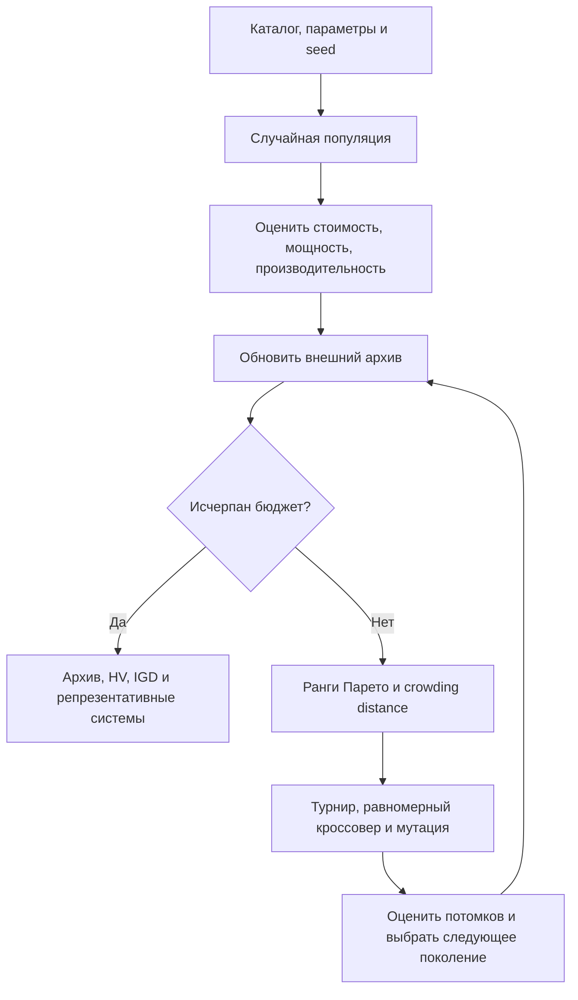
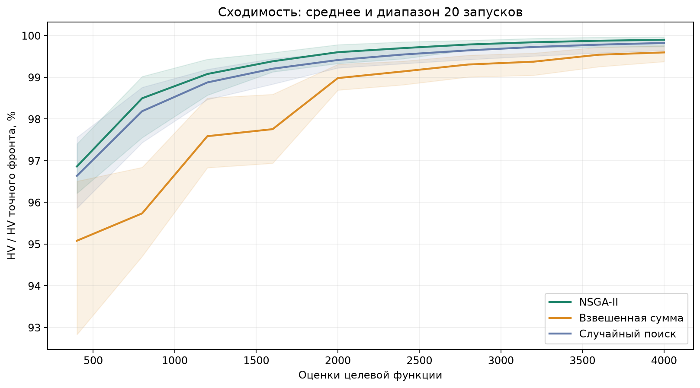
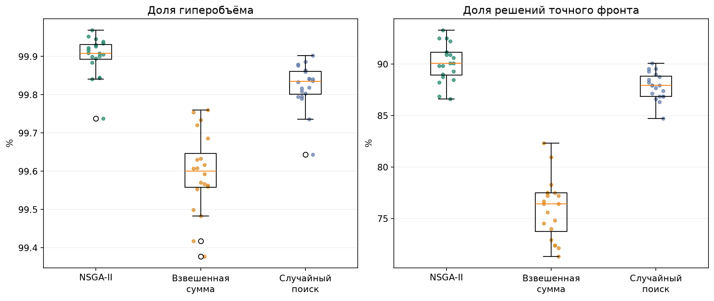
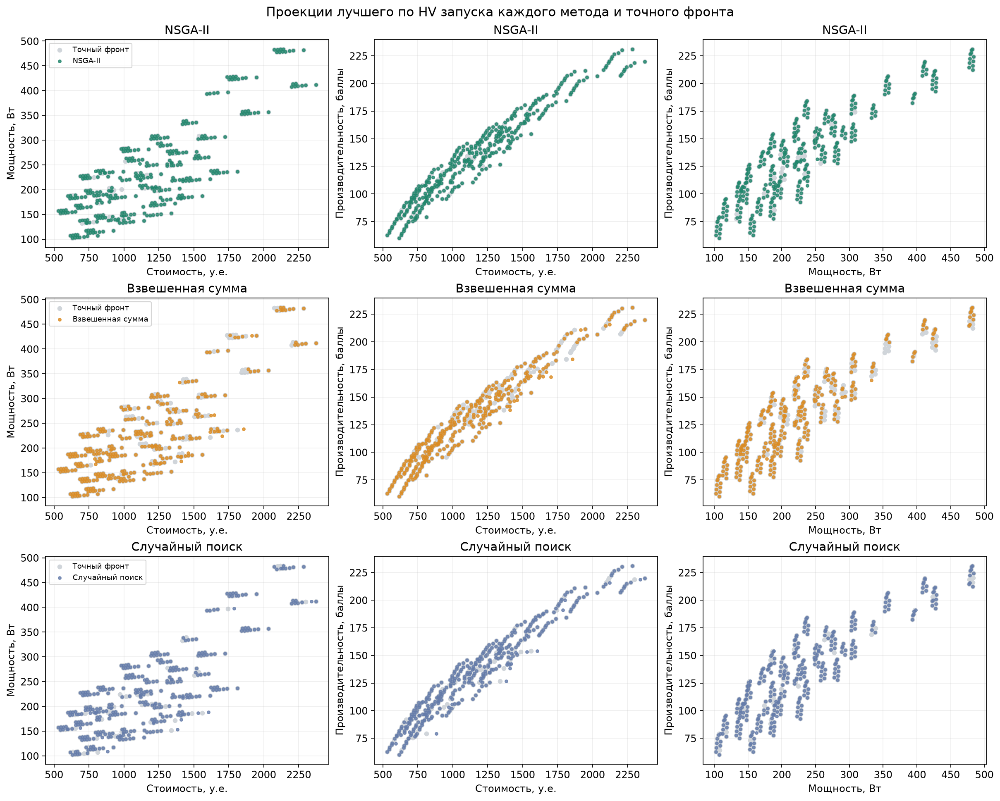

# Лабораторная работа № 3

Эволюционный синтез. Вариант 13, трек A: выбор конфигурации вычислительной системы.

## 1. Постановка и данные

Трек A выбран из двух предусмотренных методичкой треков. Номер варианта 13 сохранён по лабораторным №1–№2. Требуется получить набор компромиссов между **минимальной стоимостью**, **минимальным энергопотреблением** и **максимальной производительностью** системы.

Система состоит из CPU, GPU, RAM и накопителя. Каталог содержит 8 × 8 × 6 × 5 = **1920** сочетаний. Генотип — четыре индекса компонентов. Материнская плата и поколение памяти определяются декодером по CPU: первые четыре процессора используют DDR4, остальные — DDR5. Для DDR5 добавляется надбавка 0,5 у.е. за ГБ памяти. Стоимость платы — 100/160 у.е. соответственно. Так совместимость обеспечивается представлением. Индексы всегда остаются в диапазонах. Дополнительный лимит бюджета не вводится: стоимость является критерием, а не ограничением. Фиксированные корпус и блок питания входят в стоимость и мощность; предполагается достаточная мощность блока для всех сочетаний.

Источник — синтетический учебный каталог `data/catalogue.json`. Генератор находится в `src/problem.py`, seed **132603**. Показатели заданы учебными таблицами, к цене CPU/GPU добавляется `randint(-8,8)`. Это условные устройства и цены, а производительность — модельный балл, не результаты аппаратного бенчмарка и не рекомендации по покупке.

Цена C — сумма цен компонентов, платы и 130 у.е. фиксированной части. Мощность P — сумма мощностей компонентов и 35 Вт фиксированной части. При неизменном времени нагрузки t энергия E = P·t, поэтому минимизация P эквивалентна минимизации E для общего t. Динамика нагрузки и КПД блока питания не моделируются.

Производительность:

S = 0,5·CPUscore + 0,5·min(GPUscore, 1,3·CPUscore) + 0,5·min(RAM_GB,32) + 0,12·DiskScore.

Минимум в GPU-слагаемом моделирует ограничение со стороны CPU, а насыщение RAM — отсутствие дополнительного выигрыша сверх 32 ГБ в заданной нагрузке. Функция поиска минимизирует вектор **f = (C, P, −S)**. Более дорогие энергоэффективные компоненты и более мощные устройства создают конфликт критериев. Полный каталог:

| Категория | Компонент | Цена, у.е. | Мощность, Вт | Балл / объём RAM, ГБ |
| --- | --- | ---: | ---: | ---: |
| cpu | CPU-1 | 158 | 85 | 80 |
| cpu | CPU-2 | 243 | 35 | 75 |
| cpu | CPU-3 | 266 | 95 | 110 |
| cpu | CPU-4 | 355 | 45 | 108 |
| cpu | CPU-5 | 401 | 120 | 145 |
| cpu | CPU-6 | 496 | 65 | 138 |
| cpu | CPU-7 | 604 | 150 | 180 |
| cpu | CPU-8 | 692 | 80 | 170 |
| gpu | GPU-1 | 85 | 25 | 35 |
| gpu | GPU-2 | 154 | 55 | 65 |
| gpu | GPU-3 | 243 | 95 | 95 |
| gpu | GPU-4 | 307 | 60 | 90 |
| gpu | GPU-5 | 425 | 140 | 135 |
| gpu | GPU-6 | 558 | 110 | 150 |
| gpu | GPU-7 | 781 | 230 | 195 |
| gpu | GPU-8 | 1120 | 285 | 235 |
| ram | 8 GB | 18 | 3.5 | 8 |
| ram | 16 GB | 35 | 4.0 | 16 |
| ram | 24 GB | 53 | 4.5 | 24 |
| ram | 32 GB | 70 | 5.0 | 32 |
| ram | 48 GB | 106 | 6.0 | 48 |
| ram | 64 GB | 141 | 7.0 | 64 |
| storage | HDD-1TB | 40 | 9 | 10 |
| storage | SATA-500GB | 55 | 4 | 30 |
| storage | SATA-1TB | 85 | 5 | 38 |
| storage | NVMe-1TB | 110 | 6 | 60 |
| storage | NVMe-2TB | 185 | 7 | 68 |

## 2. Сравнение решений и нормирование

Решение a доминирует b, если по всем трём минимизируемым критериям a не хуже b, а хотя бы по одному строго лучше. Фронт Парето — недоминируемые решения. Никакой один компонент или генотип заранее не назначается «лучшим».

Поскольку пространство невелико, выполнен **отдельный полный перебор** всех 1920 сочетаний для эталона. Он дал 373 различных векторов точного фронта. Перебор не входит в поисковый бюджет и его решения не используются для инициализации или операторов поиска. Общие границы нормирования доступны всем методам: ideal = (531.0, 102.5, -231.16), nadir = (2460.0, 486.0, -60.2). Эти границы берутся по всему допустимому пространству, а не по результату отдельного запуска; постановка таким образом предполагает заранее известный конечный каталог.

Для каждого критерия используется zₖ = (fₖ − idealₖ)/(nadirₖ − idealₖ). Точка отсчёта гиперобъёма **r = (1,05; 1,05; 1,05)** одинакова во всех запусках. Точный HV эталонного фронта равен 0.62501973. HV — объём объединения прямоугольных областей [z₁,r₁]×[z₂,r₂]×[z₃,r₃]; больше — лучше. Реализация вычисляет его точно разбиением по первой координате и двумерным объединением по оставшимся.

Дополнительно измеряются IGD — среднее евклидово расстояние от точек **точного** нормированного фронта до ближайшего решения найденного архива (меньше — лучше), и recall — доля точных векторов фронта, действительно найденных поиском. Одинаковые векторы целей учитываются один раз. Малый IGD и высокий HV не означают, что найдены все конфигурации фронта.

## 3. Алгоритмы

**NSGA-II** реализован самостоятельно: попарная недоминируемая сортировка, ранги, crowding distance, бинарный турнир и элитный отбор из объединения родителей и потомков. Crowding distance суммирует нормированные расстояния до соседей по каждому критерию; крайние точки получают бесконечность, константные критерии пропускаются. Отбор предпочитает меньший ранг, затем большую разреженность. Сортировка выполняется заново при отборе следующего поколения.

Рекомбинация — равномерный кроссовер с вероятностью 0,9. Каждый из четырёх генов мутирует с вероятностью 0,25 заменой на случайный допустимый индекс. Поэтому потомки синтаксически и предметно допустимы. Инициализация — независимые случайные компоненты. Популяция — 80, бюджет — 4000 полных оценок тройки критериев, включая 80 начальных. На каждом шаге оценивается до 80 потомков, затем из объединения отбирается 80 особей.

**Взвешенная сумма** — собственный ГА с турнирной селекцией размера 3, двумя элитами и той же вариацией. Скалярная цель Σwₖzₖ/Σwₖ. Используются пять весов: (1,0,0), (0,1,0), (0,0,1), (1,1,1), (2,1,2). Общий бюджет 4000 делится на **пять независимых подпоисков по 800 оценок**, каждый с популяцией 80. Один генератор seed последовательно обслуживает эти подпоиски. Элитные оценки повторно не вычисляются. Последнее поколение подпоиска при необходимости укорочено.

**Случайный поиск** — 4000 независимых равномерных выборок четырёх индексов с возвращением.

Все три метода получают внешний архив недоминируемых решений **среди всех оценённых кандидатов**, а не только итоговую популяцию. Это даёт скалярному и случайному подходам возможность возвращать набор компромиссов. Наблюдения повторных генотипов оплачиваются из бюджета как обычные оценки, но не увеличивают архив. Реализации алгоритмов не используют готовых пакетов оптимизации.

NSGA-II способен поддерживать компромиссы за счёт рангов и разреженности; взвешенная сумма ориентируется на заданные направления и может пропускать невыпуклые участки дискретного фронта. Пять весов не исчерпывают все возможные предпочтения пользователя, поэтому сравнение относится к приложенной реализации взвешивания.

## 4. Эксперимент

По **20 запусков** трёх методов, seed 20261103–20261122, всего 60 запусков и 240 000 поисковых оценок. Seed общие для методов, генераторы отдельные. Версия Python: 3.14.7. Размеры популяций и вероятности одинаковы; различаются организация отбора и распределение бюджета между весами. Полный перебор, расчёт метрик и сохранение файлов не расходуют поисковые оценки. Измеренное время включает поисковую логику и периодическую оценку архива, поэтому это время данного программного эксперимента, а не изолированной фитнес-функции.

## 5. Результаты

HV/HVэталон, в процентах. Лучшее значение — максимум, худшее — минимум. Стандартное отклонение выборочное, делитель 19.

| Метод | Лучшее | Среднее | Медиана | Станд. откл., п.п. | Худшее |
| --- | ---: | ---: | ---: | ---: | ---: |
| NSGA-II | 99.969 | 99.900 | 99.908 | 0.052 | 99.738 |
| Взвешенная сумма | 99.760 | 99.597 | 99.600 | 0.104 | 99.377 |
| Случайный поиск | 99.902 | 99.823 | 99.835 | 0.058 | 99.644 |

| Метод | Средний IGD | Средний recall точного фронта | Средний размер архива | Среднее время, с |
| --- | ---: | ---: | ---: | ---: |
| NSGA-II | 0.001779 | 90.11% | 348.50 | 0.215 |
| Взвешенная сумма | 0.004664 | 75.90% | 313.70 | 0.120 |
| Случайный поиск | 0.002171 | 87.86% | 350.05 | 0.105 |

Размер найденного архива может включать решения, недоминируемые среди посещённых, но доминируемые точным фронтом. Поэтому большой размер архива сам по себе не означает лучшее качество.

Линия — среднее по 20 запускам, полоса — наблюдаемый минимум/максимум, а не доверительный интервал. Метрики снимаются через 400 оценок. Взвешенный метод последовательно запускает разные веса, поэтому его траектория может иметь выраженные участки роста при смене направления поиска.

На проекциях показан лучший по HV запуск **каждого** метода; остальные показатели характеризуют всю серию. Недоминируемость в трёх критериях не обязана сохраняться в двумерной проекции. Знак третьего критерия на картинке обращён: производительность показана как положительный балл.

| Парное сравнение по общему seed | Победы по HV |
| --- | ---: |
| NSGA-II против Взвешенная сумма | 20/20 |
| NSGA-II против Случайный поиск | 19/20 |

Это описательное сопоставление, без заявления статистической значимости.

## 6. Характерные конфигурации

Следующие четыре решения выбраны **из архива NSGA-II**, запуск 17, seed 20261119, имеющего лучший HV в серии. «Дешёвая» минимизирует C, «экономичная» — P, «высокопроизводительная» максимизирует S. «Сбалансированная» минимизирует евклидово расстояние до нормированного идеала. Это явное пользовательское правило выбора, а не доказательство универсальной предпочтительности или особой «точки колена».

| Решение | Комплект | Стоимость | Мощность, Вт | Производительность |
| --- | --- | ---: | ---: | ---: |
| Дешёвая | CPU-1; GPU-1; 8 GB DDR4; HDD-1TB | 531 | 157.5 | 62.70 |
| Экономичная по энергии | CPU-2; GPU-1; 8 GB DDR4; SATA-500GB | 631 | 102.5 | 62.60 |
| Высокопроизводительная | CPU-7; GPU-8; 32 GB DDR5; NVMe-2TB | 2285 | 482.0 | 231.16 |
| Сбалансированная | CPU-4; GPU-6; 32 GB DDR4; SATA-500GB | 1268 | 199.0 | 143.80 |

Дешёвая система подходит при приоритете начальных затрат; экономичная — при длительной одинаковой нагрузке; производительная — при приоритете скорости модельной задачи. Сбалансированная даёт компромисс при одинаковой важности нормированных отклонений. Все четыре соблюдают совместимость декодера. Полные генотипы и компоненты: `results/representatives.json`.

## 7. Выводы и ограничения

NSGA-II показал более высокие средние HV и recall и меньший IGD, чем пять фиксированных взвешенных подпоисков. Это согласуется с поддержанием разнообразия по всему фронту. Случайный поиск также силён: пространство содержит всего 1920 конфигураций, а бюджет позволяет многократно посещать его области. Поэтому преимущество NSGA-II над случайным поиском здесь умеренное; результат не доказывает его превосходство на любом каталоге.

В этой задаче результат можно оценить относительно **точного** фронта, а не одной удачной конфигурации. HV близок к эталону, но recall меньше 100%: отдельные редкие компромиссы остаются ненайденными. Подход взвешенной суммы проще для заранее заданных предпочтений, однако набор из пяти направлений представляет лишь часть фронта.

Ограничения: один небольшой синтетический каталог, условная модель производительности, фиксированная нагрузка, отсутствие дорожающих тарифов/надёжности/реальных сокетов и измерений. Нормирование использует заранее рассчитанные границы конечного пространства. Следующие шаги — крупный каталог, измеренная производительность, дополнительные ограничения совместимости и анализ чувствительности к весам и размеру популяции.

## 8. Воспроизводимость и защита

Команды находятся в `README.md`. `src/problem.py` восстанавливает каталог, `run_experiments.py` сохраняет все запуски, траектории, архивы и эталон; `plot_results.py` строит рисунки; `build_report.py` обновляет этот отчёт. Данные эксперимента и версия Python включены в снимок.

Для защиты: показать различие доминирования и скалярного ранжирования; объяснить роль crowding distance; открыть три проекции; сравнить четыре конфигурации; пояснить, почему высокий HV не означает нахождение всех точек и почему случайный поиск здесь достаточно силён.
