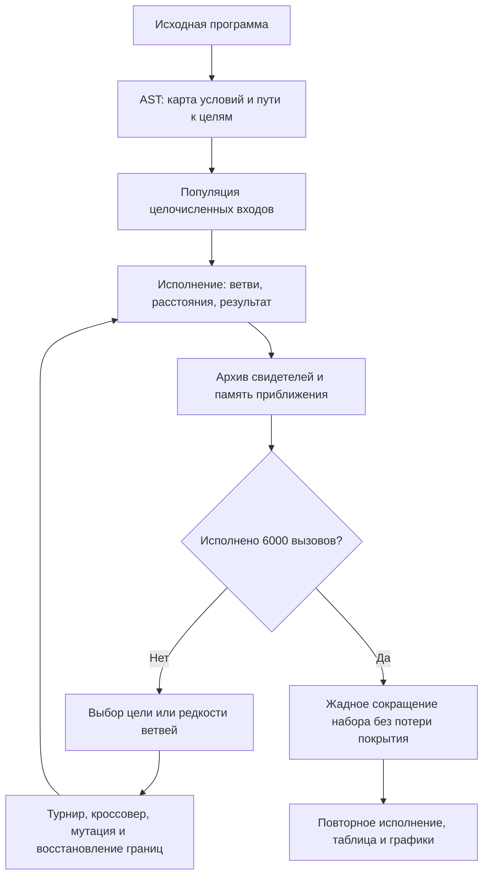
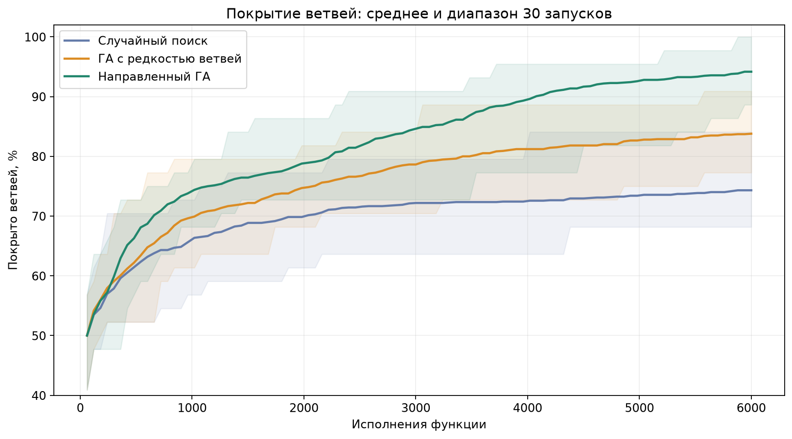
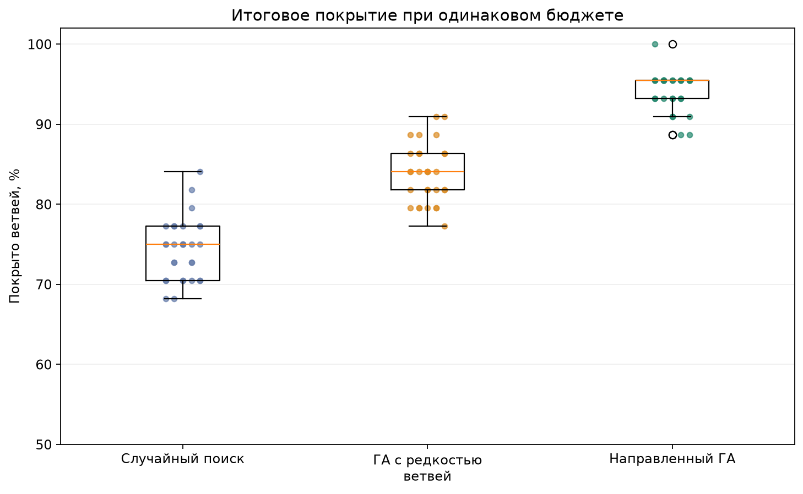
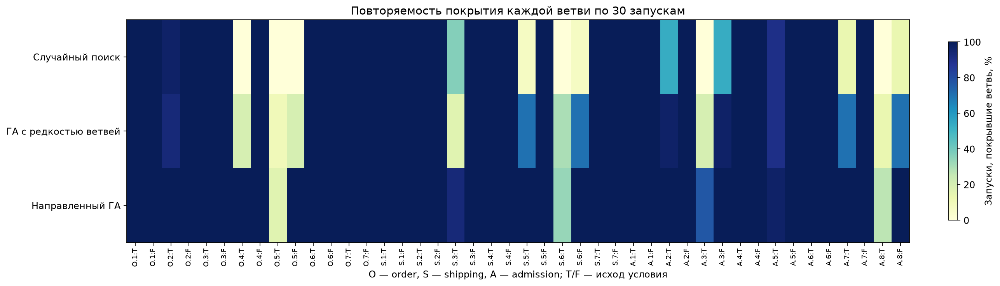

# Лабораторная работа № 4

Исследовательский проект. Вариант 13: генетический алгоритм для автоматической генерации тестовых данных, покрывающих ветви программы.

## 1. Заявка и постановка

Краткая заявка с постановкой, представлением, архитектурой, рисками и критериями подготовлена до основной реализации и приложена в `proposal.md`. Цель — исследовать поиск набора целочисленных входов, покрывающего ветви нескольких программ, и сравнить два варианта ГА при одинаковом числе исполнений.

Предмет работы — **входные данные для исследуемой программы**, а не модульные проверки реализации лабораторной. Исследуемый модуль `data/target_program.py` содержит три чистые функции `order(x,y,z)`, `shipping(x,y,z)` и `admission(x,y,z)`. Они моделируют вложенные правила обработки заказа, доставки и допуска; это искусственный объект исследования, не производственная бизнес-логика.

Генотип g = (s,x,y,z), где s ∈ {0,1,2} выбирает функцию, а x,y,z — целые числа в [−100,100]. Размер пространства **3·201³ = 24 361 803** входа. Ограничение области восстанавливается обрезанием изменённых аргументов к границам; индекс функции всегда допустим. Фенотип — один вызов выбранной функции. Набор для демонстрации строится из архива отдельных входов.

Обнаружено **22 условия и 44 ветви**: каждый `if` имеет исход T и F. Покрытие набора S:

C(S) = |⋃ᵍ∈S B(g)| / 44,

где B(g) — множество пройденных исходов условий. Цель — максимизировать C(S), затем сократить число входов без потери достигнутого покрытия. Покрытие операторов, MC/DC, исключений и путей целиком не измеряется. Для вложенных условий их исходы учитываются только при фактическом достижении условия.

## 2. Автоматическое инструментирование

`src/instrumentation.py` разбирает приложенный Python-модуль через `ast`, автоматически нумерует условия, сохраняет текст и зависимости вложенности и заменяет одиночное сравнение вызовом `_probe(id, op, a, b)`. Измеритель возвращает тот же булев результат, регистрирует пройденную сторону и вычисляет расстояние до обеих сторон. Тело программы и возвращаемые значения сохраняются. Аргументы сравнения вычисляются по одному разу. Приложенные условия не имеют внешних эффектов.

Поддерживаются `<`, `<=`, `>`, `>=`, `==`, `!=` для целых чисел и одиночные сравнения. Циклы, обработчики исключений и асинхронные функции отклоняются; BoolOp и цепочки сравнений не входят в используемый язык. Инструментированный код компилируется и исполняется как доверенный локальный исходник. Это исследовательский инструмент для приложенного модуля, не безопасная среда для произвольного чужого Python-кода. Для правильного учёта зависимостей условия представлены структурой вложенных `if/elif` без неявных переходов управления между независимыми проверками.

Карта условий (для каждого автоматически добавляются стороны `:T` и `:F`):

| Условие | Выражение | Предшествующие исходы пути |
| --- | --- | --- |
| order.1 | `x < 0` | вход функции |
| order.2 | `y == -17` | order.1:T |
| order.3 | `x == 37` | order.1:F |
| order.4 | `y == x + 11` | order.1:F, order.3:T |
| order.5 | `z == y - 7` | order.1:F, order.3:T, order.4:T |
| order.6 | `x + y > 80` | order.1:F, order.3:F |
| order.7 | `z < 0` | order.1:F, order.3:F, order.6:T |
| shipping.1 | `x > 60` | вход функции |
| shipping.2 | `y < -40` | shipping.1:T |
| shipping.3 | `z == 2 * x + y` | shipping.1:T, shipping.2:T |
| shipping.4 | `x == -61` | shipping.1:F |
| shipping.5 | `y == 23` | shipping.1:F, shipping.4:T |
| shipping.6 | `z == 7` | shipping.1:F, shipping.4:T, shipping.5:T |
| shipping.7 | `y - z > 40` | shipping.1:F, shipping.4:F |
| admission.1 | `x * x < 100` | вход функции |
| admission.2 | `y == 11` | admission.1:T |
| admission.3 | `z == x + y` | admission.1:T, admission.2:T |
| admission.4 | `x < -60` | admission.1:F |
| admission.5 | `y + z == 0` | admission.1:F, admission.4:T |
| admission.6 | `x == 40` | admission.1:F, admission.4:F |
| admission.7 | `y == 37` | admission.1:F, admission.4:F, admission.6:T |
| admission.8 | `z == -11` | admission.1:F, admission.4:F, admission.6:T, admission.7:T |

`results/branch_map.json` содержит исходные строки, пути к целям и свидетельства достижимости. До эксперимента выполнен общий для всех методов калибровочный перебор сетки из 25 значений каждого аргумента: **46875 исполнений**. Он дал вход хотя бы для каждой из 44 ветвей, то есть полное покрытие достижимо. Это не полный перебор всех 24 млн входов. Калибровочные входы не передаются поисковым алгоритмам и не входят в их бюджет; цель калибровки — установить достижимость, а не улучшить популяцию. Файл сетки и её свидетели приложены для воспроизводимости.

## 3. Расстояния до условий и фитнес

Для условия a < b расстояние до T равно max(0,a−b+1), до F — max(0,b−a). Для a <= b соответственно max(0,a−b) и max(0,b−a+1). Для `>`/`>=` аргументы меняются местами. Для a == b расстояние до T равно |a−b|, до F — 1 при равенстве и 0 иначе; для `!=` — наоборот. Нулевая величина означает достижение нужного исхода. Шаг 1 корректен для целочисленного домена.

Направленный ГА выбирает ещё не покрытую ветвь t. Для пути к ней находится первый необходимый исход, который вход не прошёл. Фитнес минимизируется:

F(g,t) = A(g,t) + d/(d+1),

где A — число требуемых исходов после первого нарушенного, d — расстояние до этого нарушенного исхода. Если цель покрыта, F = 0. Для входа другой функции задаётся значение хуже любого правильного частичного пути. Благодаря подходному уровню улучшение последнего равенства не ценится выше выполнения его внешних предпосылок.

Например, чтобы пройти `order.5:T`, нужно получить `order.1:F`, `order.3:T`, `order.4:T`, затем `z == y−7`. Вход с x = 37 и y = 48 уже достиг последнего условия; движение z к 41 улучшает фитнес. Если x не равен 37, расстояние до z не используется: сначала нужно выполнить более раннюю предпосылку.

## 4. Сравниваемые алгоритмы

**Случайный поиск** делает 6000 независимых выборок: номер функции равномерный, каждый аргумент равномерно целый из [−100,100]. Архив накапливает найденные ветви.

**ГА с редкостью ветвей** использует популяцию 60, турнир размера 3 и две элитные особи. Максимизируется Σᵦ∈B(g) 1/(1+hᵦ), где hᵦ — число предыдущих исполнений, посетивших ветвь. Редко наблюдаемые исходы получают больший вес; расстояния до ещё не пройденных условий не используются. Частоты обновляются после каждого исполнения, поэтому фитнес пересчитывается по сохранённым трассам при сравнении особей. Элиты выбираются в начале поколения.

**Направленный ГА** использует те же популяцию, турнир, элитизм и вариацию, но заменяет фитнес подходным уровнем и расстоянием. Выбирается непокрытая цель с наименьшим числом направленных оценок, затем с кратчайшим путём, затем по ID. Цель меняется после её покрытия или не более чем через 300 оценок поколения (граница проверяется между поколениями, поэтому возможен выход за интервал до одного поколения). Перед новым этапом сохраняется половина лучших по новой цели особей и добавляются случайные до 60. Отдельная память хранит ближайший когда-либо измеренный вход к каждой цели; он участвует в таком отборе и позволяет не терять прогресс при смене цели. Номер функции потомка задаётся по текущей цели. Если покрыто всё, поиск продолжает исполнение до общего бюджета, сохраняя архив.

Оба ГА используют равномерный кроссовер с вероятностью 0,9 и независимую мутацию генов с вероятностью 0,4. Номер функции мутирует случайной заменой. Для аргумента при мутации: с вероятностью 0,20 — равномерное новое значение, 0,25 — константа из исходника, 0,55 — малый шаг. Малый шаг с равной вероятностью равен ±1 либо округлённому N(0,10²). Значения обрезаются к [−100,100]. Константы извлекаются автоматически из AST и одинаковы для двух ГА: `[-100, -61, -60, -40, -17, -11, 0, 1, 2, 3, 4, 5, 6, 7, 8, 9, 11, 17, 23, 37, 40, 60, 61, 80, 100]`. Они не содержат калибровочных входов и не подставляют решения зависимых равенств.

Таким образом сравниваются два **пакета механизмов**: редкость ветвей против направленного поиска с памятью и выбором функции. Из этих опытов нельзя отдельно выделить вклад только одного branch distance без дополнительной абляции.

Сжатие набора — жадное покрытие множества: выбирается вход, покрывающий больше всего ещё не покрытых ветвей; затем удаляются избыточные входы. Оно работает с пулом найденных свидетелей, не исполняет новые случайные входы и сохраняет покрытие архива. Глобальная минимальность в общем случае не гарантируется. Уменьшение размера набора оценивается только вместе с достигнутым покрытием.

## 5. План и бюджет

Выполнено **30 независимых запусков каждого из трёх методов**, всего 90 запусков и **540 000 поисковых исполнений**. Seed: 20261103–20261132. На каждый запуск выделяется ровно 6000 вызовов одной выбранной функции, включая начальную популяцию и случайные пополнения. Повторные входы также расходуют бюджет. Элиты и кандидаты из памяти повторно не исполняются при сравнении фитнеса.

Калибровка, сокращение набора и итоговый повтор свидетелей находятся вне поискового бюджета и явно отделены в программе. Измеренное время включает поиск, трассировку и сопровождение архивов, но исключает калибровку, сокращение, повтор и графики. Python 3.14.7. При одинаковом числе исполнений направленный алгоритм выполняет больше вспомогательных вычислений; время приведено отдельно.

## 6. Результаты серии

Покрытие в процентах; больше — лучше. Стандартное отклонение выборочное, делитель 29. Полное покрытие — строго 44/44.

| Метод | Лучшее | Среднее | Медиана | Станд. откл., п.п. | Худшее | Полные запуски |
| --- | ---: | ---: | ---: | ---: | ---: | ---: |
| Случайный поиск | 84.09 | 74.32 | 75.00 | 3.83 | 68.18 | 0/30 |
| ГА с редкостью ветвей | 90.91 | 83.79 | 84.09 | 3.62 | 77.27 | 0/30 |
| Направленный ГА | 100.00 | 94.17 | 95.45 | 2.36 | 88.64 | 1/30 |

| Метод | Средний размер сокращённого набора | Среднее время, с | Медиана вызовов до 100%, только успешные |
| --- | ---: | ---: | ---: |
| Случайный поиск | 16.97 | 0.0293 | не достигнуто |
| ГА с редкостью ветвей | 19.30 | 0.0693 | не достигнуто |
| Направленный ГА | 22.43 | 0.1131 | 5822 |

Условная медиана времени достижения 100% не заменяет долю успешных запусков: направленный метод достиг полного покрытия только **в одном из 30 запусков**, поэтому соответствующая величина описывает единственное наблюдение. Неполные запуски не подменяются нулевым временем достижения. Размер набора у направленного метода больше в том числе из-за большего покрытия, поэтому эти числа нельзя трактовать как проигрыш сжатия.

Показаны среднее и диапазон min–max по 30 запускам, а не доверительная полоса. Ось x — число исполнений, шаг журналирования 60 вызовов. Полный бюджет сохраняется даже после достижения 100%.

Ниже повторяемость нескольких сложных целей: сколько запусков из 30 достигли ветви.

| Ветвь | Случайный поиск | ГА с редкостью | Направленный ГА |
| --- | ---: | ---: | ---: |
| order.5:T | 0/30 | 3/30 | 5/30 |
| shipping.3:T | 11/30 | 5/30 | 28/30 |
| shipping.6:T | 0/30 | 9/30 | 10/30 |
| admission.3:T | 0/30 | 6/30 | 23/30 |
| admission.8:T | 0/30 | 4/30 | 8/30 |

| Сравнение по одинаковому seed | Победы по покрытию | Равенства |
| --- | ---: | ---: |
| Направленный ГА против Случайный поиск | 30/30 | 0/30 |
| Направленный ГА против ГА с редкостью ветвей | 29/30 | 1/30 |

Числа описывают данную серию; проверка статистической значимости не проводилась.

## 7. Содержательная демонстрация

Лучший сохранённый набор направленного ГА: запуск **26**, seed **20261128**, покрытие **44/44**, число входов **25**. Первое полное покрытие этого запуска — на 5822-м исполнении. Входы не взяты из калибровочного перебора: это результат эволюционного поиска. Возвращаемые значения ниже получены повторным запуском инструментированной функции.

| № | Функция | x | y | z | Результат |
| ---: | --- | ---: | ---: | ---: | ---: |
| 1 | admission | 40 | 37 | -11 | 6 |
| 2 | order | 37 | 48 | 36 | 4 |
| 3 | shipping | -61 | 23 | 7 | 4 |
| 4 | order | 64 | 26 | -52 | 6 |
| 5 | shipping | 63 | -44 | 82 | 1 |
| 6 | admission | -8 | 11 | 3 | 1 |
| 7 | order | -97 | 63 | 0 | 2 |
| 8 | shipping | -71 | 87 | 99 | 8 |
| 9 | admission | -89 | 35 | -69 | 5 |
| 10 | order | -35 | -17 | 29 | 1 |
| 11 | order | 37 | -70 | -61 | 5 |
| 12 | order | 37 | 48 | 41 | 3 |
| 13 | order | 67 | 5 | 7 | 8 |
| 14 | order | 76 | 100 | 10 | 7 |
| 15 | shipping | -61 | 23 | 17 | 5 |
| 16 | shipping | -61 | 49 | 78 | 6 |
| 17 | shipping | 57 | -14 | -58 | 7 |
| 18 | shipping | 83 | -61 | 83 | 2 |
| 19 | shipping | 97 | 59 | 53 | 3 |
| 20 | admission | -72 | 0 | 0 | 4 |
| 21 | admission | -43 | 40 | 29 | 9 |
| 22 | admission | -8 | 11 | 8 | 2 |
| 23 | admission | -6 | -18 | -58 | 3 |
| 24 | admission | 40 | -18 | -17 | 8 |
| 25 | admission | 40 | 37 | 34 | 7 |

`results/best_suite.json` содержит входы и покрываемые ветви, `best_suite.csv` — таблицу. Команда `python3 lab4/src/replay_suite.py` из папки с `lab1`–`lab4` воспроизводит вызовы и выводит покрытие. Все 90 наборов сохранены в `suites.json`, а не только лучший. Вход может проходить несколько ветвей, но сам по себе не проверяет правильность бизнес-результата: покрытие — характеристика исполнения, не гарантия отсутствия ошибок программы.

## 8. Выводы и ограничения

1. Направленный ГА дал среднее покрытие **94.17%**, ГА с редкостью — **83.79%**, случайный поиск — **74.32%**. Разница направленного метода с двумя базовыми составляет 10.38 и 19.85 процентного пункта. Для приложенных вложенных равенств градиент расстояния и сохранение близких кандидатов полезнее одних частот посещения.
2. Полное покрытие достижимо и действительно получено, но только в 1/30 запусков направленного метода. Поэтому лучший набор является демонстрацией возможности, а не доказательством надёжного полного покрытия. При бюджете 6000 результат остаётся приближённым. Отрицательный исход серии также содержателен: редкие вложенные равенства остаются проблемой даже с направлением поиска.
3. Результат следует считать хорошим **относительно сравниваемых методов на этом объекте**: среднее покрытие выше при равном числе исполнений, а конечные свидетели воспроизводят заявленные ветви. Файлы `runs.csv`, `trajectories.csv`, `branch_rates.csv` позволяют увидеть устойчивость и слабые места, а не только один удачный запуск.
4. Ограничения: три короткие искусственные функции одного модуля, только целочисленные чистые выражения, отсутствие циклов и исключений, фиксированный домен и синтаксическая модель зависимостей. Не моделируются память, файлы, состояние между вызовами и побочные эффекты. Перенос на реальные большие программы потребует CFG, межпроцедурного анализа и другого учёта зависимостей.
5. Направления улучшения: адаптивный бюджет по сложным целям, сохранение выполненных предикатов при мутации, поиск SMT для отдельных равенств, несколько программ иных типов и абляция памяти/расстояния/выбора функции. Для неизвестной программы непокрытая ветвь не может автоматически объявляться недостижимой.

## 9. Демонстрация на 5–7 минут

- 0:00–0:50 — цель, пространство входов, различие покрытия ветвей и проверки правильности.
- 0:50–1:50 — исходная функция `order`, редкая ветвь `order.5:T`, автоматическая AST-карта.
- 1:50–2:50 — генотип, расстояние, подходный уровень, архив ближайших кандидатов.
- 2:50–3:50 — команда запуска сравнения, общий бюджет, 30 seed, график сходимости.
- 3:50–5:00 — повтор `best_suite.json`, вход для вложенного равенства, 44/44.
- 5:00–6:00 — статистика всей серии, только один полностью успешный запуск, ограничения и улучшения.

Для вопросов по архитектуре: объяснить сохранение семантики `_probe`, почему шаг расстояния равен 1, почему меньший набор при меньшем покрытии не обязательно лучше и почему калибровочные свидетели не являются начальными особями.

## 10. Воспроизводимость

`README.md` содержит команды установки, расчёта, воспроизведения и построения рисунков. Снимок эксперимента содержит конфигурацию, исходник исследуемой программы, список констант и версию Python. Повтор одного и того же seed даёт те же входы и покрытие на той же версии Python; время зависит от компьютера. Ключевые эволюционные операторы, измеритель расстояний, архив и сокращение набора реализованы самостоятельно, без готового пакета генерации данных.
