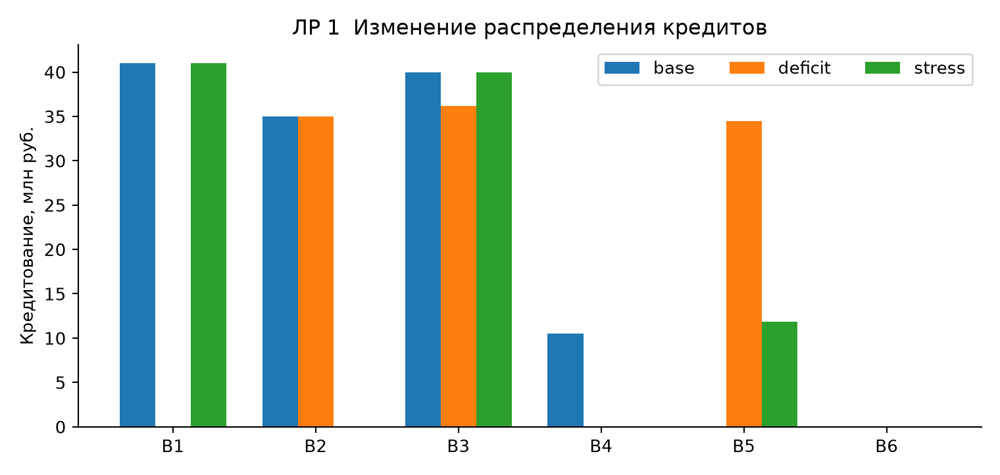

# Лабораторная работа 1
## Кредитование филиалов при ограниченных ресурсах
Кртян Левон, Б24-517. Индивидуальный вариант 13: N = 7, Q = 1, Y = 26; V = 1 + (152 mod 20) = 13. Основной seed 10107.

Цель: распределить годовой объём кредитования между шестью филиалами, максимизируя условный чистый процентный доход. Базовый оптимум даёт 17.29100690 млн руб. в год. Данные синтетические учебные; доходность уже задана после условных затрат на фондирование.

## Данные и процедура генерации
Файл data/lab1.json хранит данные отдельно от кода. Генератор src/data.py использует NumPy default_rng (PCG64), seed 10107: спрос - целые числа от 20 до 42 млн руб.; доходность - uniform(0.075, 0.16), округление до 4 знаков; риск-вес - uniform(0.25, 0.95), до 2 знаков; трудоёмкость - от 6 до 15 часов на 1 млн руб. Лимиты получаются как суммы потребления при полном спросе, умноженные соответственно на 0.62, 0.49 и 0.56, с округлением до 2 знаков. Порядок вызовов генератора зафиксирован в коде.

| Филиал | Спрос | Доходность | Риск | Часы | Кредит |
| --- | --- | --- | --- | --- | --- |
| B1 | 41 | 0.1268 | 0.55 | 7 | 41 |
| B2 | 35 | 0.1492 | 0.4 | 12 | 35 |
| B3 | 40 | 0.1407 | 0.36 | 6 | 40 |
| B4 | 35 | 0.1185 | 0.58 | 9 | 10.483 |
| B5 | 42 | 0.1459 | 0.87 | 10 | 0 |
| B6 | 20 | 0.0786 | 0.43 | 12 | 0 |

Спрос и кредит измеряются в млн руб.; доходность - млн руб. дохода на 1 млн руб. кредита за год; риск - условные млн руб. риск-взвешенных активов на 1 млн руб. кредита; часы - часы на 1 млн руб. Лимиты: фондирование 132.06, риск-взвешенный объём 57.03, рабочее время 1076.32 часов.

## Математическая модель
Множество I = {B1, ..., B6}. Параметры d[i], p[i], r[i], h[i] приведены в таблице; F, R, H - три лимита. Непрерывная переменная x[i] - годовой объём кредитования филиала в млн руб.

```math
max P = sum_i p[i] * x[i]
sum_i x[i] <= F
sum_i r[i] * x[i] <= R
sum_i h[i] * x[i] <= H
0 <= x[i] <= d[i]  for every i
```

Модель имеет 6 переменных, 9 явных неравенств и 6 условий неотрицательности. В реализации максимум преобразован в минимум отрицательного дохода. Ограничения спроса сохранены строками, чтобы их двойственные оценки были видны в полной двойственной задаче.

Допущения: кредиты делимы; доходы и потребление ресурсов линейны; риск описан фиксированным весом без корреляций и дефолтов; нет минимальной квоты филиала, лимита концентрации и требований ликвидности по срокам.

## Решение и независимая проверка
Использован открытый HiGHS через highspy, dual simplex, presolve on, один поток. Для допустимости и двойственной допустимости установлен допуск 1e-9. Статус всех трёх сценариев Optimal: решатель доказал оптимальность в рамках численных допусков.

src/verify.py не импортирует солвер и не использует матрицу модели: NumPy заново вычисляет сумму кредитов, риск, часы, границы спроса и доход. Для base, deficit, stress все отклонения и ошибка пересчёта цели не превосходят 1e-7. Результаты по каждому типу ограничения - results/lab1/checks.json; планы - solution_*.csv; лог - logs/base.log.

| Ограничение | Использовано | Лимит | Остаток | Цена |
| --- | --- | --- | --- | --- |
| funding | 126.48 | 132.06 | 5.5772 | 0 |
| risk_limit | 57.03 | 57.03 | 0 | 0.20431 |
| staff_hours | 1041.3 | 1076.3 | 34.975 | 0 |
| demand_B1 | 41 | 41 | 0 | 0.014429 |
| demand_B2 | 35 | 35 | 0 | 0.067476 |
| demand_B3 | 40 | 40 | 0 | 0.067148 |
| demand_B4 | 10.483 | 35 | 24.517 | 0 |
| demand_B5 | 0 | 42 | 42 | 0 |
| demand_B6 | 0 | 20 | 20 | 0 |



Активен риск-лимит, а также спрос B1, B2, B3. Фондирование и рабочее время имеют положительные остатки. Поэтому дополнительное фондирование само по себе в малой окрестности не приносит дохода. Первым выгодно нарастить риск-лимит: его предельная ценность 0.20431034 млн руб. годового дохода на дополнительную единицу риск-взвешенного объёма. Оценка действует вблизи текущего оптимума.

Филиалы B5 и B6 не получают финансирования, поскольку стоимость использованного ими риска превышает предельный доход. Для нулевой переменной оценка p[i] - (A^T u)[i] неположительна; расчёт приведён в reduced_costs.csv. Без квот модель допускает отказ от кредитования отдельных филиалов. На практике такое решение может требовать дополнительных ограничений региональной доступности.

## Сценарные эксперименты
base: исходные данные. deficit: фондирование уменьшено на 20%. stress: фондирование уменьшено на 20%, рабочее время на 40%. Стресс одновременно ужесточает два условия. Точные входы каждого сценария сохранены в results/lab1/scenarios/.

| Сценарий | Статус | Доход млн руб |
| --- | --- | --- |
| base | Optimal | 17.291 |
| deficit | Optimal | 15.342 |
| stress | Optimal | 12.56 |

| Изменение | Прогноз | Факт | Ошибка |
| --- | --- | --- | --- |
| deficit | 0 | -1.9494 | -1.9494 |
| stress | 0 | -4.731 | -4.731 |
| small_increase_funding | 0 | 0 | 0 |
| small_increase_risk_limit | 0.00020431 | 0.00020431 | -3.2301e-16 |
| small_increase_staff_hours | 0 | 0 | 0 |

Малые приращения каждого ресурса на 0.001 совпадают с прогнозом теневых цен с точностью вычислений. Уменьшение фондирования на 20% выходит за пределы исходного запаса 5.577241 млн руб., поэтому нулевая исходная теневая цена уже не прогнозирует конечное снижение дохода. В дефицитном плане меняются активные ограничения и состав финансируемых филиалов. В стрессовом плане дефицит времени ещё сильнее меняет структуру кредитования. Полные планы, включая нули, сохранены в CSV.

## Вывод и возможность реализации
Оптимальное распределение: B1 = 41.000000, B2 = 35.000000, B3 = 40.000000, B4 = 10.482759, B5 = 0.000000, B6 = 0.000000 млн руб. Доход равен 17.29100690 млн руб. в год. Оптимальность дополнительно подтверждена полной двойственной задачей в задании со звёздочкой 10.

План осуществим в смысле заданных ресурсных лимитов. До практического применения нужны ограничения по срокам, концентрации, минимальному обслуживанию филиалов, ожидаемым потерям и реальной регуляторной методике риска; дробный объём может интерпретироваться как портфель множества кредитов. При добавлении таких условий план следует пересчитать.
