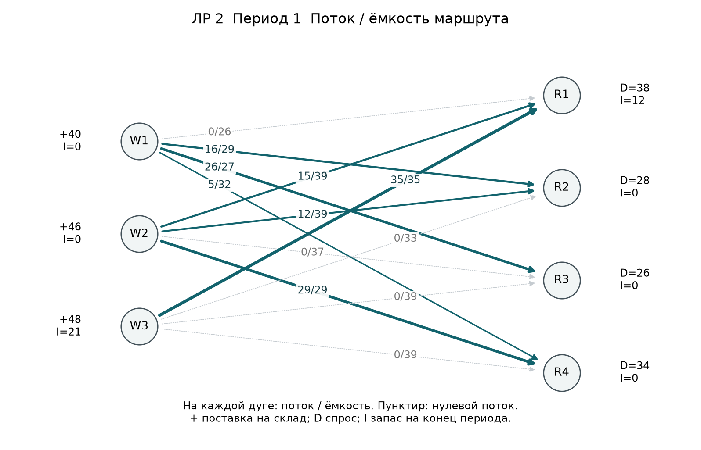
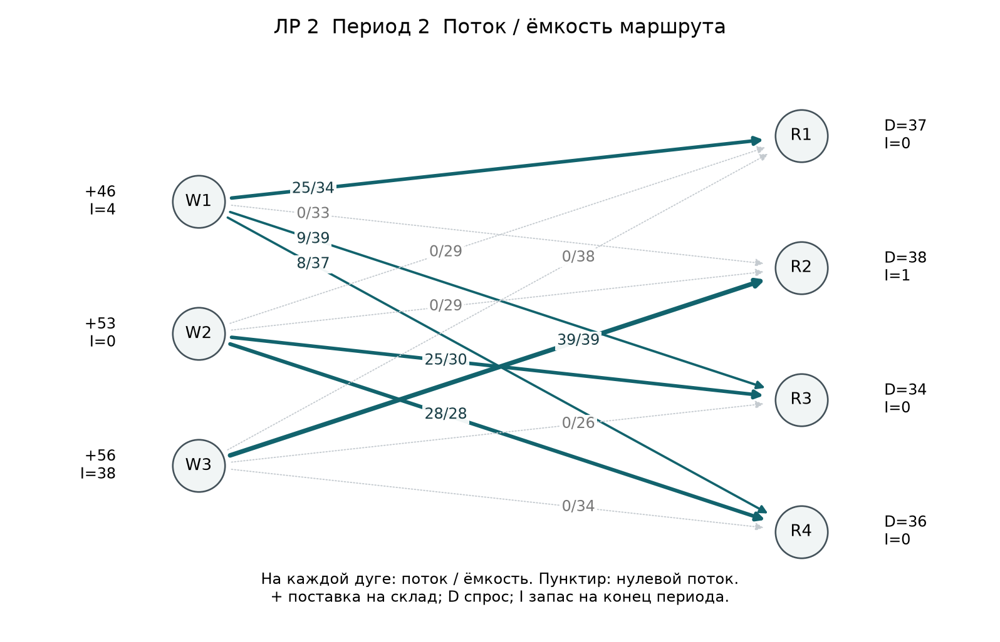
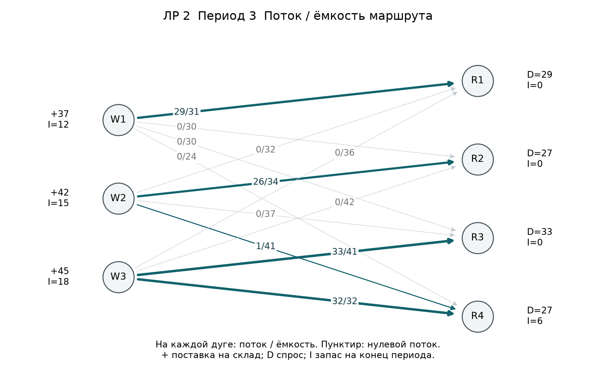
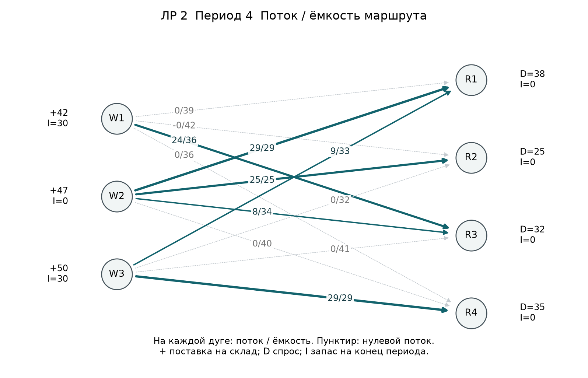
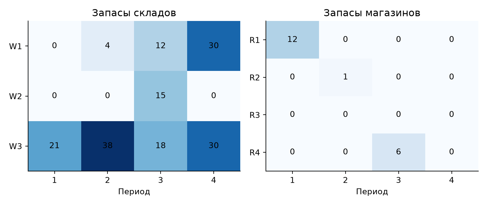

# Лабораторная работа 2
## Календарный план перевозок и запасы на четыре периода
Кртян Левон, Б24-517. Вариант 13; N = 7, Q = 1, Y = 26, seed 10107. Сеть включает 3 склада и 4 магазина. Горизонт планирования составляет 4 периода.

Цель: выполнить спрос при минимуме стоимости перевозок и хранения. Базовая оптимальная стоимость - 2180.23 тыс. руб. Жадная эвристика допустима, но дороже на 5.0187%.

## Данные и сеть
data/lab2.json сгенерирован независимым потоком PCG64 с seed 11107 = 10107 + 1000. Спрос - целые 24..40 единиц в каждом магазине и периоде. Поставки каждого периода: ceil(1.055 * суммарный спрос периода * доля склада), доли 0.30, 0.34, 0.36. Начальные запасы складов - целые 5..10. Ёмкости маршрутов - целые 24..42; тарифы - uniform(2,9) с округлением до 0.01. Хранение на складах - uniform(0.4,0.9), в магазинах - uniform(1.2,2), до 0.01. Предельные запасы склада и магазина соответственно 80 и 30 единиц.

| Узел | t1 | t2 | t3 | t4 | Начальный запас |
| --- | --- | --- | --- | --- | --- |
| W1 | 40 | 46 | 37 | 42 | 7 |
| W2 | 46 | 53 | 42 | 47 | 10 |
| W3 | 48 | 56 | 45 | 50 | 8 |

| Узел | t1 | t2 | t3 | t4 |
| --- | --- | --- | --- | --- |
| R1 | 38 | 37 | 29 | 38 |
| R2 | 28 | 38 | 27 | 25 |
| R3 | 26 | 34 | 33 | 32 |
| R4 | 34 | 36 | 27 | 35 |

Единица потока и запаса - условная делимая единица товара; тариф и хранение - тыс. руб. за единицу и за единицу за период соответственно. Поставки поступают в начале периода, спрос удовлетворяется в этом же периоде, хранение оплачивается по остатку на конец периода, включая последний.

Использована сеть, развёрнутая во времени. Вершины (W[w],t) и (R[j],t); 48 транспортных дуг W->R внутри периода; 21 дуга переноса запасов между периодами; начальные запасы задают внешнее предложение. Конечные запасы также являются переменными и учитываются в стоимости. Запасы не являются потерянным товаром. Сеть в четырёх срезах показана ниже; значения межпериодных потоков даны на отдельной схеме запасов и в inventory_base.csv.

## Формальная модель
W = {1,2,3}, J = {1,2,3,4}, T = {1,2,3,4}. Параметры: s[w,t] - поставки; d[j,t] - спрос; C[w,j,t] - ёмкости; c[w,j,t] - тариф; hW[w], hR[j] - хранение; KW[w], KR[j] - складские лимиты; начальные IW[w,0], IR[j,0] заданы.

Непрерывные переменные f[w,j,t] - перевозки; IW[w,t], IR[j,t] - остатки в конце периода. Всего 48 + 12 + 16 = 76 переменных и 28 балансовых равенств.

```math
min Z = sum_(w,j,t) c[w,j,t]*f[w,j,t]
      + sum_(w,t) hW[w]*IW[w,t] + sum_(j,t) hR[j]*IR[j,t]
IW[w,t-1] + s[w,t] - sum_j f[w,j,t] = IW[w,t]
IR[j,t-1] + sum_w f[w,j,t] - d[j,t] = IR[j,t]
0 <= f[w,j,t] <= C[w,j,t]
0 <= IW[w,t] <= KW[w]; 0 <= IR[j,t] <= KR[j]
```

Время доставки считается нулевым внутри периода; нет потерь, неделимых рейсов, неопределённости спроса и экономии от масштаба. Поставки обязательны; оставшийся товар можно хранить. Допущение линейных тарифов позволяет использовать непрерывную ЛП.

## Решение и проверка
HiGHS dual simplex, presolve on, один поток, численный допуск солвера 1e-9. Базовый статус Optimal. В src/verify.py отдельно пересчитаны балансы каждого склада и магазина за каждый период, неотрицательность, каждая ёмкость и каждый лимит хранения. Цель пересчитана как сумма перевозок и остатков, умноженных на исходные тарифы. Все ошибки <= 1e-7. Полный протокол - checks.json; 28 балансов - balances.csv; все 48 дуг - solution_base.csv.











## Узкие места и двойственные оценки
Ниже перечислены насыщенные транспортные дуги. Цена ёмкости - изменение минимальной стоимости на единицу увеличения верхней границы; неположительная оценка означает возможность экономии. В столбце «Факт dC» ёмкость увеличена на 0.001 единицы.

| Маршрут | Период | Поток | Цена ёмкости | Факт dC |
| --- | --- | --- | --- | --- |
| W2->R1 | 4 | 29 | -0.76 | -0.00076 |
| W2->R2 | 4 | 25 | -0.47 | 0 |
| W2->R4 | 1 | 29 | -0.04 | -4e-05 |
| W2->R4 | 2 | 28 | -1.43 | -0.00143 |
| W3->R1 | 1 | 35 | -0.86 | -0.00086 |
| W3->R2 | 2 | 39 | -1 | -0.001 |
| W3->R4 | 3 | 32 | -0.06 | -6e-05 |
| W3->R4 | 4 | 29 | -1.87 | -0.00187 |

Насыщенность сама по себе не гарантирует строгую предельную экономию. Для W2->R2 в периоде 4 найденная двойственная оценка отрицательна, но увеличение ёмкости на 0.001 не уменьшает стоимость: в этой точке функция стоимости недифференцируема, двойственное решение не единственно. Возвращаемая цена является допустимой опорной оценкой, но одностороннее фактическое изменение нужно проверять перерешиванием. Наибольшая подтверждённая локальная экономия у W3->R4 в периоде 4.

## Сценарии и диагностика несовместимости
Самый загруженный физический маршрут выбран по сумме базовых перевозок за четыре периода: W2->R2, 63 единиц. При равенстве используется порядок индексов. overload: его ёмкость уменьшена на 50% во всех периодах. failure: маршрут полностью закрыт на весь горизонт. growth: весь спрос увеличен на 20%, поставки прежние. stress: рост спроса на 20% и отказ этого маршрута одновременно.

| Сценарий | Статус | Стоимость | Спрос |
| --- | --- | --- | --- |
| base | Optimal | 2180.2 | 517 |
| overload | Optimal | 2196.7 | 517 |
| failure | Optimal | 2225.7 | 517 |
| growth | Infeasible | нет плана | 620.4 |
| stress | Infeasible | нет плана | 620.4 |

Отказ увеличивает оптимальную стоимость на 45.52 тыс. руб., или 2.0879%. Остальные пути позволяют выполнить исходный спрос.

В growth и stress статус Infeasible: допустимого плана для всех исходных ограничений нет. Суммарно доступно 577 единиц с учётом начального запаса, а требуется 620.4. Из суммирования балансов и неотрицательности конечных запасов следует необходимое условие «спрос <= предложение + начальные запасы». Оно нарушено на 43.4 единицы; расширения транспортной ёмкости недостаточно для устранения общей нехватки товара.

Для уточнения конфликтов решена вспомогательная ЛП: добавить к каждому балансу магазина u[j,t] >= 0, ограничить u[j,t] <= d[j,t] и минимизировать sum u[j,t], сохраняя поставки, ёмкости и хранение. Это минимальное неудовлетворение спроса в фиксированной сети, не алгоритм IIS. При growth минимум равен 43.400000, при stress - 43.400000 единиц. Распределение дефицита - unmet_*.csv; проверка исправленного спроса - diagnostics.json; логи - elastic_*.log. Если минимум превосходит 43.4, разница вызвана локальными ограничениями доставки и сроков.

## Сравнение с жадной эвристикой
Эвристика обрабатывает периоды по порядку и внутри периода перебирает маршруты по возрастанию тарифа. На каждой дуге перевозит минимум доступного запаса, оставшегося спроса и ёмкости. Будущее и стоимость хранения при выборе маршрута не учитываются. Остаток хранится на складе. Эвристический план проходит ту же независимую проверку.

Стоимость эвристики - 2289.65 тыс. руб.; оптимум - 2180.23; абсолютный зазор - 109.42; относительный - 5.0187%. Измеренное время эвристики 0.000169 с, решения ЛП 0.000600 с; это малые разовые измерения на данном компьютере, а не универсальное сравнение скорости. Модель учитывает все периоды одновременно и может выгодно перенести часть потока и запасов во времени.

## Практическая интерпретация
Базовый план осуществим в учебной сети; нулевые потоки означают неиспользуемые из-за стоимости или иных ограничений маршруты. Для реальных перевозок нужно добавить время в пути, дискретные машины, сроки годности, безопасность запасов и неопределённость поставок. В несовместимых сценариях необходимы дополнительные закупки, снижение или перенос спроса; простое переключение маршрутов не устраняет нарушение общего баланса.
