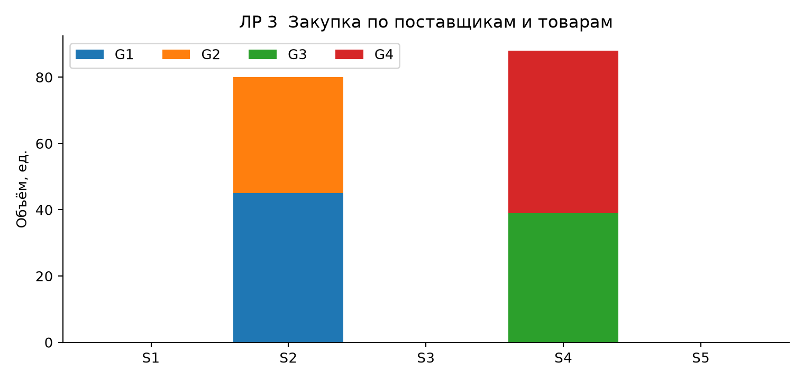
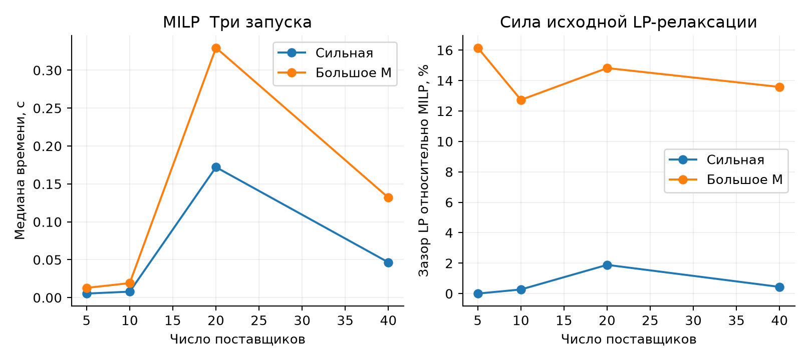

# Лабораторная работа 3
## Выбор поставщиков с объёмными скидками
Кртян Левон, Б24-517. Вариант 13; N = 7, Q = 1, Y = 26, seed 10107. Основной пример: 5 поставщиков, 4 товара, 3 тарифных уровня на поставщика.

Цель: покрыть спрос с минимальной суммой закупки и фиксированных затрат оформления заказа. Основная MILP выбирает поставщиков и тарифы дискретно; объёмы поставки непрерывны. Оптимальная стоимость базового плана - 653.442500 тыс. руб.

## Данные и единицы
Файл data/lab3.json. Генератор PCG64 с seed 12112 = 10107 + 2000 + 5. Для масштаба n используется seed = 10107 + 2000 + n. Спрос каждого из четырёх товаров: целое 34..50, умноженное на n/5 и округлённое до 0.01. Ёмкости поставщиков - целые 75..105; базовые цены - uniform(3,8), до 0.01; фиксированные затраты - целые 25..60. Все товары имеют общую условную единицу ёмкости. Речь об учебных поставщиках и ценах.

| Поставщик | G1 | G2 | G3 | G4 | Ёмкость | Открытие |
| --- | --- | --- | --- | --- | --- | --- |
| S1 | 6.7 | 6.18 | 6.49 | 5.49 | 91 | 56 |
| S2 | 4.85 | 4.42 | 6.51 | 7.52 | 102 | 28 |
| S3 | 7.01 | 4.24 | 5.48 | 3.22 | 92 | 26 |
| S4 | 6.3 | 7.5 | 3.68 | 3.42 | 103 | 44 |
| S5 | 6.08 | 7.93 | 3.08 | 7.22 | 91 | 59 |

Спрос {G1, G2, G3, G4} = [45.0, 35.0, 39.0, 49.0] единиц. Цена - тыс. руб. за единицу; оформление - тыс. руб. за активного поставщика на горизонт. Скидки применяются ко всем единицам заказа у поставщика: T1 - 0% при объёме 0..30; T2 - 7% при 30..60; T3 - 15% при 60..C[i]. На общей границе разрешён более дешёвый тариф. Плата за оформление предотвращает выгодное открытие с нулевым заказом.

## Формальная MILP
I - поставщики; J = {1,2,3,4} - товары; K = {1,2,3} - тарифы. Параметры: d[j] - спрос, p[i,j] - базовая цена, C[i] - мощность, F[i] - фиксированная плата, delta[k] - скидка. L = (0,30,60); U[i,k] = min((30,60,+infinity)[k], C[i]).

z[i,k] бинарна: выбран тариф k поставщика i. q[i,j,k] >= 0 - непрерывная закупка товара j по этому тарифу. v[i,k] = sum_j q[i,j,k] - вспомогательное обозначение, не отдельная переменная.

```math
min Z = sum_(i,j,k) p[i,j]*(1-delta[k])*q[i,j,k]
      + sum_(i,k) F[i]*z[i,k]
sum_(i,k) q[i,j,k] = d[j]  for every j
sum_k z[i,k] <= 1         for every i
sum_(j,k) q[i,j,k] <= C[i]
L[k]*z[i,k] <= v[i,k] <= U[i,k]*z[i,k]
q[i,j,k] <= min(d[j],U[i,k])*z[i,k]
q[i,j,k] >= 0; z[i,k] in {0,1}
```

Последние поштучные связки усиливают LP-релаксацию и верны при целых z: поставщик не может поставить товара больше общего спроса, а объём тарифа не превосходит U. Модель содержит 60 непрерывных и 15 бинарных переменных, 104 строки. Скидка «на весь объём» и фиксированное оформление требуют дискретного выбора; чистая ЛП может оплачивать лишь дробную часть открытия поставщика.

## Решение и проверка MILP
HiGHS, branch-and-cut, presolve on, threads=1, random_seed=10107, mip_rel_gap=0, time_limit=30 секунд. Статус Optimal, финальный зазор ветвления 0; нижняя оценка 653.442500 совпадает с найденной стоимостью в численных допусках.

| Поставщик | Тариф | Объём | G1 | G2 | G3 | G4 |
| --- | --- | --- | --- | --- | --- | --- |
| S2 | 3 | 80 | 45 | 35 | 0 | 0 |
| S4 | 3 | 88 | 0 | 0 | 39 | 49 |



src/verify.py заново проверяет спрос каждого товара, мощность каждого поставщика, неотрицательность, бинарность, выбор не более одного тарифа, обе границы диапазона объёма и все связки q-z. Отдельно пересчитываются цены со скидками и плата за открытие. Для всех трёх сценариев ошибки не выше 1e-7. CSV содержит также невыбранные тарифы и нулевые объёмы.

## LP релаксация и интегральный зазор
В релаксации требование z in {0,1} заменено на 0 <= z <= 1, остальные ограничения сохранены. Z_LP = 653.442500, Z_MILP = 653.442500. Абсолютный зазор равен 0.00000000; относительный, определённый как 100*(Z_MILP-Z_LP)/abs(Z_MILP), равен 0.000000%.

На базовых данных LP-релаксация даёт целочисленное решение. Полные значения q и z - lp_plan.json, компактная таблица - solution_lp.csv.

На том же генераторе при n = 10 появляются дробные z; пример из фактического LP-решения:

| Поставщик | Тариф | z | Объём |
| --- | --- | --- | --- |
| S9 | 3 | 0.91026 | 71 |

Дробное открытие позволяет оплатить только часть фиксированной платы при дробном выборе тарифного диапазона. В реальном решении нельзя открыть долю договора: после возврата бинарности стоимость повышается. Результаты масштабов 10, 20 и 40 подтверждают ненулевой интегральный зазор в общем случае.

## Сценарии
deficit: мощность крупнейшего по базовому объёму выбранного поставщика S4 сокращена на 20%. stress: этот поставщик недоступен, а спрос каждого товара повышен на 20%. Исходные данные не редактируются; отдельные сценарные JSON сохраняются автоматически.

| Сценарий | Стоимость | Поставщики | Тарифы |
| --- | --- | --- | --- |
| base | 653.44 | S2; S4 | S2:T3; S4:T3 |
| deficit | 666.91 | S2; S4 | S2:T3; S4:T3 |
| stress | 783.32 | S2; S3; S5 | S2:T3; S3:T3; S5:T2 |

В дефицитном сценарии поставщики и тарифы сохраняются, а объёмы закупок и стоимость меняются. В стрессовом сценарии меняется состав поставщиков и тарифов. Во всех трёх сценариях получен статус Optimal.

## Жадная эвристика
На каждом шаге рассматриваются невыбранные поставщики. Для каждого строится максимальный возможный заказ из оставшегося спроса, начиная с его самых дешёвых товаров; определяется доступный по общему объёму тариф и полная стоимость с оформлением. Выбирается минимальная средняя стоимость на единицу; повторяется до покрытия спроса. Эвристика не решает MILP и не пересматривает ранние решения.

Эвристика прошла независимую проверку. Стоимость 696.235000 тыс. руб.; превышение оптимума 6.5488%. Время эвристики 0.000193 с, основной MILP 0.005425 с.

## Масштабирование и влияние большого M
Для сравнения построена эквивалентная по целым решениям слабая модель: граница v <= U сохраняется безусловно, а связь с бинарной переменной записана как v <= M*z с M = 1000000. Нижние границы тарифов сохранены, поштучные усиливающие связки удалены. Если z = 0, v = 0; если z = 1, v <= U. Поэтому целые допустимые планы совпадают с основной моделью. Увеличение M не заменяет физический лимит мощности.

В основной модели обоснованное M для тарифа равно U[i,k] <= 105; для отдельного товара достаточно min(d[j],U[i,k]). При искусственно большом M LP допускает очень малое z при существенном заказе, ослабляя оплату фиксированных затрат и порог объёмной скидки. Слабая релаксация не даёт физически реализуемого плана.

| n | Модель | LP | MILP | LP зазор % | Секунды |
| --- | --- | --- | --- | --- | --- |
| 5 | strong | 653.44 | 653.44 | 0 | 0.0053348 |
| 5 | weak | 547.87 | 653.44 | 16.156 | 0.012805 |
| 10 | strong | 1182.7 | 1185.9 | 0.26783 | 0.0078515 |
| 10 | weak | 1034.9 | 1185.9 | 12.732 | 0.019141 |
| 20 | strong | 2195.4 | 2237.6 | 1.8866 | 0.17209 |
| 20 | weak | 1906 | 2237.6 | 14.82 | 0.32962 |
| 40 | strong | 3909 | 3926.2 | 0.43704 | 0.046466 |
| 40 | weak | 3393 | 3926.2 | 13.579 | 0.13183 |



Для каждой пары формулировок использованы одинаковые данные. В таблице приведены медианы трёх запусков. Во всех запусках получен статус Optimal, mip_gap = 0. При n = 20 время решения выше, чем при n = 40. Сравнение релаксаций приведено в задании со звёздочкой 6.

## Вывод и практические ограничения
Фиксированные затраты и объёмные скидки существенно влияют на выбор поставщиков. Для применения нужны реальные договорные правила о границах скидок, сроках, минимальных партиях каждого товара, качестве и риске срыва поставок. Дробные объёмы допустимы для делимого товара; при неделимых упаковках необходимо ввести дополнительные целочисленные переменные. Плата за открытие в этой модели взимается один раз на горизонт, а не на каждую единицу товара.
